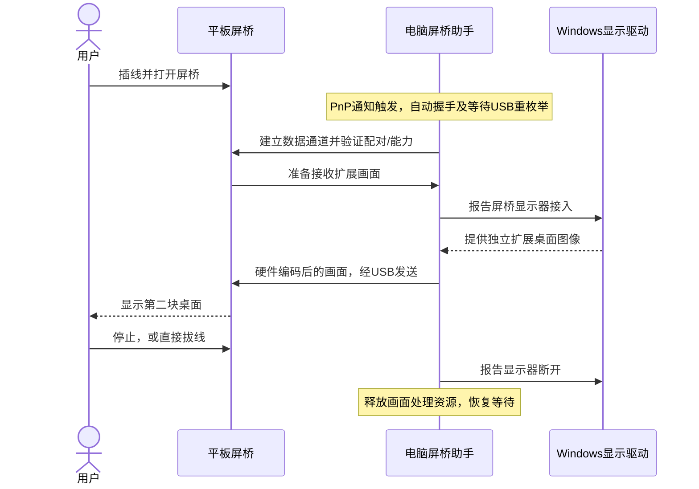

# 推荐实现方案：一次配置，平板发起，电脑自动扩展

更新：2026-11-02。用户已接受电脑首次配置一次、日常运行低占用后台监测。本文是基于当前实测的工程建议，尚不是已实现或验证通过的产品架构。

## 推荐结论

主线采用 **Windows 屏桥助手 + 间接显示驱动（IDD）+ 普通 USB 数据通道 + 原生鸿蒙接收应用**。电脑首次安装必要组件、完成配对后，用户日常只需连接数据线并打开平板屏桥。助手自动处理连接，平板就绪后才向 Windows 报告显示器接入并传输画面。

这里实现的是用户看到的“平板启动软件后，电脑自动出现扩展屏”。平板 USB 接口仍传输数据；Windows 的虚拟显示组件负责让系统出现第二块屏幕。无需把平板改造成硬件 DP/HDMI 接收器。

## 插线即用的硬件屏为何不同

| 方案 | 电脑为何能出现第二屏 | 本工程取舍 |
| --- | --- | --- |
| HDMI/DP 或 USB-C DP Alt Mode 便携屏 | 屏端有视频接收电路，显卡输出视频，系统经显示链路识别屏幕 | 本轮没有证据表明该平板提供原生 DP/HDMI 输入；普通应用不能补出接收硬件 |
| DisplayLink 等 USB 显示设备 | 电脑驱动创建/管理显示输出，设备接收并还原画面 | 整体分工可供理解；本工程不集成或模拟其私有协议/设备身份 |
| 屏桥纯软件方案（推荐） | 自己的 Windows 显示驱动创建显示器，后台传输，平板应用解码显示 | 符合普通数据线、一次电脑配置、低占用待机和原生鸿蒙应用方向 |
| HDMI 采集卡 + 平板应用 | 电脑显卡通过 HDMI 识别采集端，采集卡把视频转换为 USB 输入供平板查看 | 需要额外硬件、HDMI 输出和线材；鸿蒙识别采集卡仍待实测，仅作为备选 |

USB 网络共享也可以承载画面，但平板应用能否自动启用、系统是否记住开关尚未验证，不能默认它满足“日常零配置”。不将它替换成当前主线。

若坚持直接使用平板原有接口接收 DP/HDMI，需要厂商提供对应硬件和系统支持；目前没有可确认的普通应用方案。自定义 USB 描述符、伪装一个显示设备名称或者刷固件，都不能自动解决视频接收电路及 Windows 显示驱动问题。

## 两端组件与职责

| 组件 | 推荐实现及职责 | 加载时机 |
| --- | --- | --- |
| 屏桥助手的监测部分 | 原生 Windows 小程序，首选 C++；监听 PnP，管理连接状态、配对和显示会话 | 用户登录自动启动，日常不要求管理员权限；权限模型需验证 |
| USB 访问组件 | 使用 Windows 自带 WinUSB，必要时由有签名的 INF/CAT 注册匹配规则、设备接口 GUID 和访问权限 | 首次配置登记；连接时由系统加载 |
| 屏桥显示驱动 | 基于微软 UMDF/IddCx，报告显示器接入、分辨率和断开，取得该显示器的桌面图像 | 安装后按需工作；平板未就绪时不保留已连接的空屏 |
| 画面处理部分 | 获取 IDD 对应的桌面图像，优先 GPU 硬件 H.264 编码，经 USB 发送 | 平板启用且能力协商成功后启动，停止或拔线后释放编码器、纹理和传输队列 |
| 平板屏桥 | ArkTS 界面，公开 USB accessory API；使用系统原生视频解码器输出到 Surface | 打开应用进入等待连接；用户可以停止扩展 |

首版限定当前 Windows 11 x64 和当前参考平板，不据此承诺其他 Windows 版本/架构兼容。Python/PyUSB 继续作为开发诊断工具，不作为低占用常驻组件的选型。

监测部分首选登录用户进程，首版不引入长期以管理员身份运行的系统服务。IDD 自身由系统在驱动宿主中运行，不能把用户桌面/托盘逻辑放到驱动 Session 0。跨进程图像交接、显卡适配器选择和硬件编码可用性列入单独验证任务，尚未证明零拷贝。

## 首次配置和日常流程

首次在电脑运行一个安装器：检测系统 → 安装已签名的 USB 访问配置和显示驱动 → 配置助手登录自启 → 与平板完成一次配对 → 做一次真实扩展显示自检。平板首次允许必要的配件授权。安装、升级与卸载应由同一产品入口管理，不能要求用户逐个找驱动或手动改注册表。

打开平板应用先记录“愿意接收扩展”的状态。底层 AOA 握手仍由电脑作为 USB host 发起，但由助手自动完成。若应用先启动或线先插入，都应收敛到同一连接状态，不要求用户按顺序执行电脑命令。

助手只在验证平板准备好后才创建连接中的显示器；仅检测到 USB 不能触发桌面输出。Windows 首次将屏桥屏幕设为扩展，后续尽量复用已保存的分辨率、缩放及布局，不随意改动其他显示器。停止或拔线后报告显示器断开，窗口恢复效果另做实测。

`start` 留在开发工具中，由生产助手实现相应握手；`echo` 留在诊断工具中，正式连接使用能力协商和会话控制，不运行持续随机数据回传。应用未启动、锁屏和休眠时的自动唤起能力继续分别验证，首版以平板前台解锁为前提。

## 如何做到低占用

监测采用 `CM_Register_Notification` 等系统事件通知。先注册，再枚举一次已经连接的设备，并对重复通知去重。回调只投递事件，USB 操作在工作任务中进行。无设备时阻塞等待，不每秒遍历 USB、不定时启动 PowerShell/HDC、不运行视频编码器。

建议状态为：未连接 → 发现目标 → 等待重枚举 → 等待平板就绪 → 建立显示 → 传输中 → 断开清理。超时和失败采用有限重试；无法安装的设备进入“需要首次配置”状态，不持续尝试修改驱动或反复切换模式。再次插拔、系统恢复和用户重试触发新的检查。

建议的**待实测指标**：监测程序私有内存不超过 30 MiB；未插线稳定 10 分钟的累计 CPU 时间不超过 0.6 秒（相当于单逻辑核 0.1%）。同时记录工作集、相关驱动宿主和其他屏桥进程，不能仅展示最小进程来掩盖总开销。连接但平板未就绪时也要单独测量。

传输中的 GPU 编码、USB 和平板解码必然有额外开销；低占用常驻指等待状态，不承诺传输中也只有上述占用。首个画面目标仍为 1080p60，实际以测得的帧率、延迟和资源占用为准。

## USB 路径仍有两个硬关口

1. **配件模式的数据访问。** 真机已切到 `18d1:2d00` 并在平板打开配件，Windows 当前仍报代码 28。需要完整且有签名的 WinUSB 安装配置，包含应用可枚举的接口 GUID，并验证跨端口/重启重插无需再次绑定。单纯手选系统 WinUSB 不足以证明一次配置完成。
2. **正常模式的自动起连。** 之前只从已启用 HDC 的 `12d1:5000` 做过握手。必须关闭调试/HDC依赖后，从用户日常 USB 模式验证自动发送握手和重枚举。协议不要求调试，并不证明该平板普通模式下的 Windows 访问路径已通。不能仅解决 `18d1:2d00` 就宣布一插即用。

安装器需分别覆盖这两个状态的访问需求。不能无差别匹配所有 USB 设备或替换整类手机的 MTP/HDC 驱动；正常文件传输受到的影响也要记录。`18d1:2d00/2d01` 是共享的配件身份，助手还需核对会话身份与配对，不能只看 VID/PID 就把桌面发给任意配件。

若正常模式起连无法通过可发布的接口和签名配置实现，暂停将 AOA 当作最终产品通道，输出结论后再评估 USB 网络或外置采集方案。不得自动切换为 HDC 转发。

## 下一轮验证顺序

| 顺序 | 工作 | 通过证据 |
| --- | --- | --- |
| 1 | 确定 WinUSB 包的 INF、接口 GUID、签名和卸载路径；检查现有匹配驱动与 WDK 工具 | 目标身份正常，标准用户进程可打开接口；没有签名包时如实记录工具/签名缺口 |
| 2 | 用现有 echo 原型验证双向通信，再做无 HDC 的正常模式起连 | 真机校验记录；初始 USB 身份、握手和重枚举均留证据 |
| 3 | 制作 PnP 监测小原型，自动握手、等待平板并恢复断线 | 两种启动顺序均成功，后台无需命令；无虚假显示成功状态 |
| 4 | 独立编译/验证屏桥 IDD | Windows 显示设置出现可扩展的屏桥显示器，与已有第三方虚拟显示无关 |
| 5 | 整合硬编、USB、鸿蒙硬解码和启停控制 | 两块屏可显示不同窗口；平板就绪后自动开始，拔线后显示器移除 |
| 6 | 覆盖两类数据端口、重插和低占用 | 有 PD/无 PD 各 30 分钟、各 20 次插拔，跨端口和重启不重复配置；记录待机占用 |

实际系统安装时仍使用正常签名与管理员安装机制；本方案不依赖关闭签名验证或改系统测试模式。用户接受一次配置不等于这些技术关口已经通过。

## 来源和当前证据

- [当前实测报告](validation/M0_USB_2026-11-02.md)：握手、平板打开配件及 Windows 代码 28 的证据。
- [微软 IDD](https://learn.microsoft.com/en-us/windows-hardware/drivers/display/indirect-display-driver-model-overview)：创建虚拟显示适配器、报告显示器、处理桌面图像。
- [微软 PnP 通知](https://learn.microsoft.com/en-us/windows/win32/api/cfgmgr32/nf-cfgmgr32-cm_register_notification)：事件回调及已有接口的首次枚举规则。
- [微软 WinUSB 安装](https://learn.microsoft.com/en-us/windows-hardware/drivers/usbcon/winusb-installation)：接口 GUID、自定义 INF/CAT 和手工安装的限制。
- [AOA 官方协议](https://source.android.com/docs/core/interaction/accessories/aoa)：主机握手和配件数据通道；HarmonyOS 的实际支持以真机结果为准。
- [DisplayPort over USB-C](https://www.displayport.org/displayport-over-usb-c/) 与 [DisplayLink 分工](https://www.synaptics.com/cn/products/displaylink-graphics/corporate/how)：两类插线显示的差异。
- [采集硬件输入和 EDID 示例](https://www.magewell.com/tech-specs/usb-capture-hdmi-gen-2)：说明外置采集路径，不构成该产品或鸿蒙兼容性推荐。
- 本机 SDK 存在 USB 配件连接事件、原生视频解码/Surface API、USB 摄像头连接类型；类型定义只证明有接口，不证明当前平板的兼容性、性能和后台行为。
